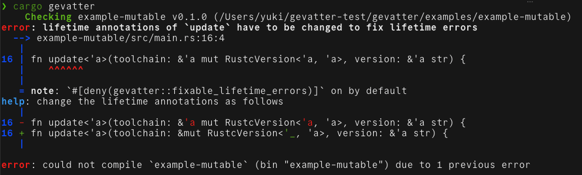

<div align="center">
  <h1>
    🕯<br>
    Gevatter
  </h1>
  <p>
    Diagnoses and fixes lifetime annotations where rustc and Clippy offer no automatic fix
  </p>
  <p>
    
  </p>
</div>

## Installation

```bash
cargo install cargo-gevatter --locked
```

Or downloading `cargo-gevatter` binary from release.

Required toolchains are downloaded by `cargo-gevatter` on first run.

## Usage

```bash
cargo gevatter
```

## Examples

Run `cargo gevatter` on `examples/small-annotation-errors`;
You can see detailed lifetime annotation error messages and suggested fixes:

```
error: lifetime annotations of `switch` have to be changed to fix lifetime errors
 --> examples/small-annotation-errors/src/main.rs:5:4
  |
5 | fn switch<'a>(t: &'a Two, flag: bool) -> &'a str {
  |    ^^^^^^
  |
  = note: `#[deny(gevatter::fixable_lifetime_errors)]` on by default
help: change the lifetime annotations as follows
  |
5 - fn switch<'a>(t: &'a Two, flag: bool) -> &'a str {
5 + fn switch<'a, 'b, 'c>(t: &Two<'b, 'c>, flag: bool) -> &'a str where 'b: 'a, 'c: 'a {
  |

error: lifetime annotations of `first` have to be changed to fix lifetime errors
 --> examples/small-annotation-errors/src/main.rs:8:4
  |
8 | fn first<'a>(t: Two<'a, 'a>) -> &'a str {
  |    ^^^^^
  |
help: change the lifetime annotations as follows
  |
8 - fn first<'a>(t: Two<'a, 'a>) -> &'a str {
8 + fn first<'a>(t: Two<'a, '_>) -> &'a str {
  |
```

You can execute it with fixed sources without applying the fixes by running `cargo gevatter run`.
To apply these fixes, run `cargo gevatter fix`.

There are some examples that can be automatically fixed by Gevatter in `examples`.

## Build

Please install Rust building environment before building Gevatter.

To build Gevatter, run:

```bash
./x cargo build --release -p cargo-gevatter -p gevatter_driver
```

To change or contribute Gevatter, you can use:

```bash
export RUST_COMPONENTS="rustfmt,clippy,rust-analyzer,rust-src"
./x cargo clippy --workspace
```

Try removing `~/.gevatter` if there are some problems.

## Related Discussions

- There is [an issue #148315](https://github.com/rust-lang/rust/issues/148315) that discusses lifetime annotation suggestion improvement
- There is a paper that proposes lifetime fixing method based on rustc's diagnostics ([DOI: `10.1145/3622821`](https://doi.org/10.1145/3622821))
  - We think this project is conservative: not trying to change existing APIs

## Miscellaneous

The name, Gevatter, comes from Grimms' Fairy Tales.

### Acknowledgements

We used Claude Fable 5.2 to know conventions for writing English and Rust code. Note that we wrote the code by hands.

### License

All contents of this project can be used under Apache License 2.0:

```
Copyright 2026 Yuki Okamoto

Licensed under the Apache License, Version 2.0 (the "License");
you may not use this file except in compliance with the License.
You may obtain a copy of the License at

    http://www.apache.org/licenses/LICENSE-2.0

Unless required by applicable law or agreed to in writing, software
distributed under the License is distributed on an "AS IS" BASIS,
WITHOUT WARRANTIES OR CONDITIONS OF ANY KIND, either express or implied.
See the License for the specific language governing permissions and
limitations under the License.
```

A full text of the license is also enclosed in LICENSE file.
